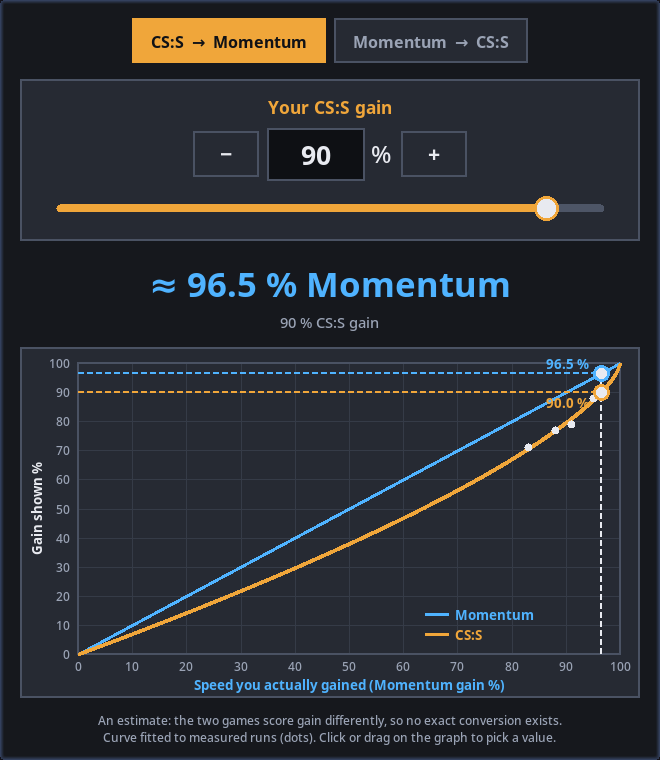

# Gain Converter

Turns a CS:S gain % (the SSJ plugin's number) into a [Momentum Mod](https://momentum-mod.org/) gain % and back, and shows both on a graph.



- The switch at the top picks which game's gain you type in.
- Type a number in the box (Enter applies it), use − and +, drag the slider, or click on the graph.
- The graph's bottom axis is the speed you actually gained, which is what Momentum's gain measures. So Momentum is the straight line and CS:S the curve under it.

## How good is the number?

It's an estimate. The two games score gain differently, so no exact conversion exists:

- CS:S (SSJ) scores each tick by how far your angle is from the best one. Being off costs you linearly.
- Momentum compares the speed you gained with the most you could have gained. Being off a little costs you very little.

The curve is `Momentum = 1 − (1 − CS:S)^1.45`. It's fitted to runs and top replays on bhop_ambience that were measured both ways with [Strafe Review](https://github.com/Soulmanyes/strafe-review) (the white dots), and it matches them to within about 1 point. Jumps with very uneven strafes can land a few points off.

## Install

### Windows

Download `gain-converter-windows.zip` from the [latest release](https://github.com/Soulmanyes/gain-converter/releases/latest), unzip it and double-click `gain-converter.exe`. Windows Defender or SmartScreen may warn, because the exe isn't signed.

### Linux (or Windows with Python)

Needs Python 3 with tkinter (Arch/CachyOS: `pacman -S tk`; Debian/Ubuntu: `apt install python3-tk`). No other packages.

```
git clone https://github.com/Soulmanyes/gain-converter
python gain-converter/gain_converter.py
```

## Licence

CC0 1.0 (see `LICENSE`). The Windows exe also bundles Python, Tcl/Tk and the PyInstaller bootloader; their licences are in the zip (see `THIRD-PARTY-NOTICES.txt`).
